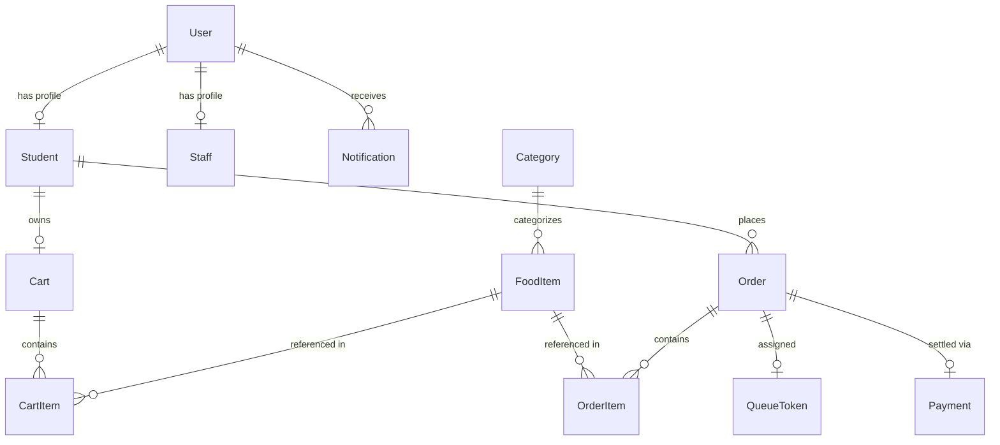

# 🍽️ CanteenQ — Smart Campus Canteen Queue & Food Ordering System
## Comprehensive Technical & Architectural Documentation

---

## 📑 Table of Contents
1. [Executive Summary](#1-executive-summary)
2. [Problem Statement & Background](#2-problem-statement--background)
3. [Objectives of CanteenQ](#3-objectives-of-canteenq)
4. [Technology Stack Deep-Dive](#4-technology-stack-deep-dive)
5. [System Architecture & Working](#5-system-architecture--working)
6. [Detailed User Portals & Features](#6-detailed-user-portals--features)
7. [Database Architecture & Schema Design](#7-database-architecture--schema-design)
8. [API Architecture (GraphQL & WebSockets)](#8-api-architecture-graphql--websockets)
9. [Deployment & CI/CD Pipeline](#9-deployment--cicd-pipeline)
10. [Security & Authentication Model](#10-security--authentication-model)
11. [Future Scope & Evolutionary Roadmap](#11-future-scope--evolutionary-roadmap)
12. [Conclusion](#12-conclusion)

---

## 1. Executive Summary

**CanteenQ** is an enterprise-grade campus canteen queue and digital food ordering platform designed to eliminate long physical queues, order mismanagement, and unpredicted dining rushes across university and college campuses.

By unifying a **Next.js 14** (App Router) frontend, a modular **NestJS 10** backend communicating over **Code-First GraphQL** and real-time **Socket.io WebSockets**, and a managed **Supabase Cloud PostgreSQL** database orchestrated via **Prisma ORM**, CanteenQ provides:
- **Instant visibility into dining hall congestion** via a real-time Campus Crowd Meter.
- **Predictable ordering** with algorithmic wait times and dynamic queue counters.
- **Efficient kitchen orchestration** through an interactive, multi-stage Kitchen Kanban board.
- **Cryptographic fraud prevention** with automated counter pickup QR codes.
- **Continuous integration and delivery** via a 5-stage GitHub Actions CI/CD pipeline and Vercel edge deployment.

---

## 2. Problem Statement & Background

### 2.1 The Traditional Campus Dining Dilemma
In high-density academic environments, recess and lunch periods are compressed into narrow 45–60 minute intervals (e.g., 12:30 PM – 1:30 PM). During these peak intervals, hundreds of students converge simultaneously on limited billing and food distribution counters, resulting in:

1. **Prolonged Counter Wait Times**: Students typically spend 20 to 35 minutes standing in line merely to place orders and pay, leaving minimal time to consume their food.
2. **Zero Wait-Time Transparency**: Prior to walking across campus, students have no knowledge of whether the canteen is empty or operating at over-capacity.
3. **Billing Inefficiencies & Token Discrepancies**: Physical paper tokens and cash handoffs create accounting mistakes, lost tokens, and disputed food collections.
4. **Kitchen Overwhelm & Food Wastage**: Kitchen staff experience erratic, unmanaged verbal spikes. This causes prolonged preparation delays, stockouts of popular meals, or over-preparation resulting in food spoilage.
5. **Absence of Administrative Insights**: Campus administration and catering contractors lack real-time data regarding sales volume, peak hours, dish turnaround speed, and inventory trends.

---

## 3. Objectives of CanteenQ

* **Digital Queuing**: Transition students from physical lines to a virtual queue accessible from any smartphone, laptop, or hostel room.
* **Transparent Wait-Time Estimation**: Calculate and display realistic wait times based on active kitchen load, dish preparation complexity, and orders ahead.
* **Kitchen Operational Harmony**: Equip chefs with a live, drag-free Kanban board that updates automatically upon order placement without verbal calling.
* **Frictionless Counter Handoff**: Eliminate paper slips by generating verifiable cryptographic QR codes once an order reaches the `READY` state.
* **Predictive Demand Forecasting**: Leverage historical order velocity to predict peak rush periods and assist kitchen leads in ingredient preparation.

---

## 4. Technology Stack Deep-Dive

| Architectural Layer | Technology | Version | Purpose & Rationale |
| :--- | :--- | :--- | :--- |
| **Frontend Framework** | **Next.js (App Router)** | `14.2.20` | Server-side rendering, React Server Components, fast route transitions, and image optimization. |
| **Frontend Styling** | **Tailwind CSS + Lucide Icons** | `3.4.16` | Modern dark-mode glassmorphic interface (`#0d1117`, `#161b27`) with lightweight, responsive UI components. |
| **Data Visualization** | **Recharts** | `2.15.0` | Declarative, responsive SVG charting for admin revenue, order volume, and dish popularity analytics. |
| **API Communication** | **GraphQL (Apollo Server)** | `12.2 / 4.11` | Code-First strongly typed GraphQL schema eliminating over-fetching and under-fetching. |
| **Real-time Engine** | **Socket.io** | `4.8.1` | Bidirectional WebSocket pub/sub broadcasting live queue position, status transitions, and crowd updates. |
| **Backend Framework** | **NestJS** | `10.4.15` | Scalable TypeScript architecture with modular dependency injection, guards, decorators, and interceptors. |
| **Cloud Database** | **Supabase (PostgreSQL 16)** | Managed Cloud | High-availability PostgreSQL database with PgBouncer / Supavisor connection pooling for high concurrent throughput. |
| **ORM Layer** | **Prisma ORM** | `5.22.0` | Type-safe database queries, ACID multi-table transactions, declarative schema modeling, and automated migrations. |
| **Frontend Hosting** | **Vercel** | Production | Edge CDN distribution, automated SSL termination, and sub-second Next.js page generation. |
| **Containerization** | **Docker & Docker Compose** | `20-Alpine` | Multi-stage, reproducible builds for containerized production and development parity. |
| **CI/CD Pipeline** | **GitHub Actions** | `v4 Workflows` | 5-stage automated build, Jest unit testing, Docker validation, Supabase schema push, and Vercel production deploy. |

---

## 5. System Architecture & Working

```text
┌────────────────────────────────────────────────────────────────────────┐
│               Frontend: Next.js 14 App Router (Vercel)                 │
│   - TypeScript, Tailwind CSS, Dark Mode Glassmorphism UI               │
│   - Unified GraphQL Client (lib/graphql.ts)                            │
│   - Real-time WebSocket Client (Socket.io) for Live Queue Updates      │
│   - Portals: Student Ordering, Kitchen Kanban, Executive Admin         │
└───────────────────────────────────┬────────────────────────────────────┘
                                    │ GraphQL Queries / Mutations / WebSockets
┌───────────────────────────────────▼────────────────────────────────────┐
│                    Backend: NestJS 10 (Port 4000)                      │
│   - Code-First GraphQL Schema (@nestjs/graphql, Apollo Server)         │
│   - WebSocket Gateway (@nestjs/websockets, Socket.io)                  │
│   - 19 Modular Domain Services (Auth, Menu, Orders, Queue, Analytics)  │
│   - Dynamic Queue Engine: wait time calculation, order queue position  │
│   - Prediction Engine: peak hours, crowd density, demand forecasting   │
└───────────────────────────────────┬────────────────────────────────────┘
                                    │ Prisma Client (Pooled: 6543 / Direct: 5432)
┌───────────────────────────────────▼────────────────────────────────────┐
│               Cloud Database: Supabase (PostgreSQL 16)                 │
│   - Hosted Cloud PostgreSQL with PgBouncer / Supavisor connection pool │
│   - 14 Relational Models (User, Order, QueueToken, FoodItem, etc.)     │
│   - Automated Schema Push & Migration via Prisma ORM                   │
└────────────────────────────────────────────────────────────────────────┘
```

### Operational Workflow:
1. **Pre-Dining Phase**: The student checks the **Campus Crowd Meter** on the landing page or dashboard. If load is acceptable, they browse the digital menu.
2. **Order Placement**: The student selects food items, customizes quantities, adds prep notes, and chooses a payment method (UPI, Card, Net Banking, or Instant Test Mode).
3. **Atomic Transaction**: The NestJS backend converts the student's cart into an `Order`, decrements food stock, generates a unique campus queue token (e.g. `SQ-104`), and records the payment atomically inside a Prisma transaction.
4. **Kitchen Notification**: The order immediately materializes on the Kitchen Staff Kanban board via WebSocket event `QUEUE_UPDATED` with no page refresh needed.
5. **Kitchen Progression**: Kitchen staff progress the order through four stages:
   $$\text{PLACED} \longrightarrow \text{ACCEPTED} \longrightarrow \text{PREPARING} \longrightarrow \text{READY}$$
6. **Counter Pickup**: When marked `READY`, the student's screen flashes green, sound cues trigger, and a dynamic cryptographic **QR Code** is rendered for the counter staff to scan/verify.
7. **Order Completion**: Counter staff hand over the meal and mark the order `COMPLETED`, releasing the token from the active queue.

---

## 6. Detailed User Portals & Features

### 🎓 6.1 Student Portal (`/`, `/menu`, `/cart`, `/checkout`, `/order/[id]`, `/orders`)
* **Campus Crowd Meter**: Real-time crowd percentage (0–40% LOW, 41–70% MODERATE, 71–100% HIGH), queue length, and estimated waiting time before ordering.
* **Interactive Menu Catalog**:
  * 6 categories: *Meals, Breakfast, Snacks, Beverages, Fast Food, Desserts*.
  * Search by dish name or description.
  * Instant Vegetarian toggle filter.
  * Stock badges: *Available*, *Low Stock (< 10)*, and *Sold Out*.
* **Persistent Shopping Cart**: Synchronized with browser storage, computing subtotal, packaging/tax fees, and total in real time.
* **Live Order Stepper**: Dynamic 6-stage status tracker with real-time countdown of "Orders Ahead of You".
* **Cryptographic QR Code**: Rendered using `qrcode.react` upon reaching `READY` status.
* **Order History**: Past receipt breakdown with 1-click reorder functionality.

### 👨‍🍳 6.2 Kitchen Staff / Chef Portal (`/staff`)
* **Real-time Kanban Board**: 4 operational columns:
  1. **New Orders**: Incoming placed and accepted orders.
  2. **In Preparation**: Dishes currently cooking at preparation stations.
  3. **Ready for Pickup**: Cooked orders awaiting counter collection.
  4. **Completed Today**: Fulfilled orders archived for daily velocity metrics.
* **One-Click State Transitions**: Actions to `Accept`, `Start Preparing`, `Mark Ready`, `Complete`, or `Reject`.
* **Live Inventory Manager**: Kitchen staff toggle dishes between Available and Sold Out, or adjust stock numbers and prep times on the fly.

### 🛡️ 6.3 Campus Admin & Analytics Portal (`/admin`)
* **Executive KPI Cards**: Today's Gross Revenue, Total Orders Placed, Average Waiting Time, Turnaround Velocity, and Order Cancellation Rates.
* **Visual Recharts Graphs**:
  * Hourly order volume distribution bar chart.
  * Revenue distribution across categories.
  * Top popular dishes ranking table.
* **AI Prediction Engine**:
  * Predicts upcoming peak rush windows (e.g., 8:30 AM – 9:30 AM, 12:30 PM – 2:00 PM).
  * Forecasts expected order counts and wait minutes for the next 4 hours.
  * Identifies high-demand food items to guide kitchen ingredient prep.

---

## 7. Database Architecture & Schema Design

Managed via Prisma ORM connected to Supabase Cloud PostgreSQL, the database comprises 14 relational tables:



| Model | Primary Key | Key Fields | Relationships |
| :--- | :--- | :--- | :--- |
| **`User`** | `id (CUID)` | `name`, `email`, `role`, `passwordHash`, `isActive` | 1:1 `Student`, 1:1 `Staff`, 1:N `Notification` |
| **`Student`** | `id (CUID)` | `studentId`, `department`, `semester`, `className` | 1:1 `User`, 1:1 `Cart`, 1:N `Order` |
| **`Staff`** | `id (CUID)` | `employeeId`, `designation`, `shift` | 1:1 `User` |
| **`Canteen`** | `id (CUID)` | `name`, `location`, `openingTime`, `closingTime`, `maxCapacity` | Standalone master entity |
| **`Category`** | `id (CUID)` | `name` (unique), `description` | 1:N `FoodItem` |
| **`FoodItem`** | `id (CUID)` | `name`, `price`, `preparationTime`, `stockQuantity`, `isAvailable`, `isVeg` | N:1 `Category`, 1:N `CartItem`, 1:N `OrderItem` |
| **`Cart`** | `id (CUID)` | `studentId` (unique), `totalAmount` | 1:1 `Student`, 1:N `CartItem` |
| **`CartItem`** | `id (CUID)` | `quantity`, `unitPrice`, `subtotal` | N:1 `Cart`, N:1 `FoodItem` |
| **`Order`** | `id (CUID)` | `orderNumber`, `status`, `paymentStatus`, `totalAmount`, `estimatedWaitingTime` | N:1 `Student`, 1:N `OrderItem`, 1:1 `QueueToken`, 1:1 `Payment` |
| **`OrderItem`** | `id (CUID)` | `quantity`, `unitPrice`, `subtotal` | N:1 `Order`, N:1 `FoodItem` |
| **`QueueToken`** | `id (CUID)` | `tokenNumber (SQ-xxx)`, `position`, `status`, `estimatedWaitTime` | 1:1 `Order` |
| **`Payment`** | `id (CUID)` | `transactionId`, `provider`, `amount`, `currency`, `status` | 1:1 `Order` |
| **`Notification`**| `id (CUID)` | `title`, `message`, `type`, `isRead`, `createdAt` | N:1 `User` |
| **`QueueSnapshot`**| `id (CUID)`| `timestamp`, `queueLength`, `activeOrders`, `crowdPercentage` | Time-series data for AI predictions |

---

## 8. API Architecture (GraphQL & WebSockets)

### 8.1 GraphQL Code-First Schema
CanteenQ utilizes `@nestjs/graphql` with Apollo Server on `/graphql`. Resolvers map business logic directly to strongly typed schemas:

```graphql
type Query {
  getMenu(categoryId: String, search: String, isVeg: Boolean, availableOnly: Boolean): [FoodItemType!]!
  getCategories: [CategoryType!]!
  getCrowdDensity: CrowdDensityType!
  getMyOrders: [OrderType!]!
  getOrder(id: ID!): OrderType!
  getAnalytics: AnalyticsType!
  getPredictions: PredictionType!
  getNotifications: [NotificationType!]!
}

type Mutation {
  login(email: String!, password: String!): AuthResponseType!
  register(input: RegisterInput!): AuthResponseType!
  createOrder(paymentMethod: String!): OrderType!
  acceptOrder(orderId: ID!): OrderType!
  startPreparing(orderId: ID!, estimatedMinutes: Int): OrderType!
  markReady(orderId: ID!): OrderType!
  completeOrder(orderId: ID!): OrderType!
  cancelOrder(orderId: ID!, reason: String): OrderType!
  updateFoodAvailability(foodItemId: ID!, isAvailable: Boolean!, stockQuantity: Int): FoodItemType!
}
```

### 8.2 Real-time WebSocket Events (`QueueGateway`)
Socket.io operates on the same server instance to broadcast real-time state changes without polling overhead:

* `QUEUE_UPDATED`: Dispatched whenever a token is created, progressed, or resolved.
* `ORDER_STATUS_CHANGED`: Dispatched specifically to the student tracking an active order.
* `FOOD_AVAILABILITY_CHANGED`: Broadcast to all active menus when an item sells out.
* `CROWD_DENSITY_CHANGED`: Updates the top-bar Crowd Meter across all connected clients.

---

## 9. Deployment & CI/CD Pipeline

### 9.1 Frontend Deployment: Vercel
* Deployable directly from the `frontend/` directory with zero manual configuration.
* Protected by custom security headers in [`frontend/vercel.json`](file:///c:/Users/chris/OneDrive/Desktop/CanteenQ/frontend/vercel.json):
  * `X-Frame-Options: DENY` (prevents clickjacking)
  * `X-Content-Type-Options: nosniff` (prevents MIME type sniffing)
  * `Referrer-Policy: strict-origin-when-cross-origin`

### 9.2 Database: Supabase Cloud PostgreSQL
* **Pooled Connection (`DATABASE_URL`, Port 6543)**: Connects via PgBouncer / Supavisor for high concurrent runtime queries.
* **Direct Connection (`DIRECT_URL`, Port 5432)**: Direct connection for Prisma CLI migrations (`prisma db push`).

### 9.3 GitHub Actions Workflow (`.github/workflows/ci-cd.yml`)
The automated CI/CD pipeline runs on pushes to `main` and pull requests:
1. **Backend Validation**: Installs dependencies with `npm ci`, generates Prisma client, runs `npm run build`, and executes Jest unit tests.
2. **Frontend Validation**: Runs `npm run build` across all 14 Next.js routes ensuring 0 type errors.
3. **Docker Build**: Validates multi-stage Docker container builds for backend and frontend.
4. **Supabase Schema Push**: Automatically synchronizes database schema changes to the live Supabase instance.
5. **Vercel Production Deploy**: Builds and deploys the prebuilt production Next.js bundle to Vercel edge networks.

---

## 10. Security & Authentication Model

1. **Password Hashing**: Passwords are encrypted using **bcrypt** with a salt factor of 10. Plain text passwords are never persisted.
2. **Stateless JWT Authentication**: Authenticated sessions issue signed JSON Web Tokens (`accessToken`) containing `userId` and `role`.
3. **Role-Based Access Control (RBAC)**:
   * `@Roles(Role.STUDENT)`: Ordering, cart, personal order tracking.
   * `@Roles(Role.STAFF, Role.ADMIN)`: Kitchen Kanban operations, food stock toggles.
   * `@Roles(Role.ADMIN, Role.COLLEGE_ADMIN)`: Revenue reports, AI predictive metrics.
4. **CORS Governance**: Configured in NestJS bootstrap to strictly permit:
   * Local development (`http://localhost:3000`)
   * Any Vercel preview or production domain (`*.vercel.app`)
   * Custom production domains specified via `FRONTEND_URL`.

---

## 11. Future Scope & Evolutionary Roadmap

CanteenQ is designed with modular microservices boundaries, allowing straightforward integration of next-generation features:

1. **Campus RFID / Smart Card Tap-to-Pay**: Integration with existing university student ID cards via NFC readers at pickup counters to debit campus meal allowances directly.
2. **Computer Vision-Based Crowd Meter**: Mounting overhead cameras at canteen entrances running lightweight YOLO / OpenCV object-detection models to count physical chairs occupied and validate virtual queue density.
3. **Dedicated Kitchen Display System (KDS)**: Hardware touch terminals with waterproof bump bars and wireless ESC/POS thermal ticket printers for kitchen prep stations.
4. **Automated Supplier Replenishment**: Connecting food item stock depletion directly with local food vendor purchase orders to automatically re-order raw ingredients before stockouts occur.
5. **Multi-Canteen & Multi-Vendor Federation**: Expanding from a single central canteen to multi-facility campuses with cafeterias, coffee kiosks, juice bars, and late-night food trucks within one unified app.
6. **Nutritional & Allergen Tracking**: Enabling students to set calorie goals, view macronutrient splits (protein, carbs, fat), and filter meals by allergens (gluten-free, peanut-free, lactose-free).

---

## 12. Conclusion

CanteenQ delivers a complete, production-ready solution to one of the most persistent operational pain points in campus life: uncoordinated, congested canteen queues. 

By unifying **Next.js 14**, **NestJS 10**, **GraphQL**, **WebSockets**, **Supabase Cloud PostgreSQL**, and **Prisma ORM**, the platform delivers transparency to students, operational tranquility to kitchen staff, and actionable predictive data to campus leadership.

---
*Document Version: 1.0.0 (Production Release) | October 2026 | All rights reserved.*
